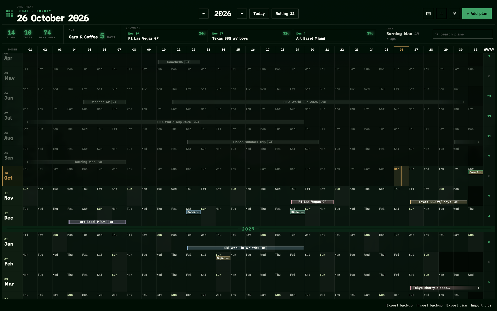

<p align="center">
  
</p>

<p align="center"><b>Your whole year on one screen. A local-first year calendar for Omarchy, with no backend, no account and no build step.</b></p>

<p align="center">
  
</p>

## Features

- **Whole year at a glance.** Months run down one scrolling board, with the day numbers pinned at the top. "Rolling 12" starts at the current month.
- **Fast planning.** Drag across days to add a plan, drag a bar to move it, or drag its ends to resize it.
- **Trips, events and reminders.** One-day plans show as small markers. Trips add up to a "days away" count per month and for the year.
- **Dashboard strip.** Shows the next and last plan, this month, what's coming up, and how many days you've been away.
- **Notes, links, checklists and up to four images per plan.** Checklist progress shows on the bar, for example `Canada · 8d · 3/7`.
- **Search** with `/`, **undo** with `Ctrl+Z`, and full keyboard navigation (press `?`).
- **Backup and calendar files.** Export and import JSON backups, with or without images, and `.ics` calendar files.
- **Matches your Omarchy theme.** The planner reads the colors from your active theme each time it opens.
- **Bar button.** Left-click opens the planner. Right-click pins the board on the wallpaper, or puts your wallpaper back.

## Privacy

Everything stays on your machine.

- Plans and notes are saved in your browser's `localStorage`, and images in IndexedDB.
- No server, no account, no analytics, and no tracking.
- The page loads no fonts, scripts or images from the network.
- Data leaves your device only when you export a file yourself.

## Install as an Omarchy plugin

```sh
omarchy plugin add https://github.com/KarPage/oma-year-planner --enable
```

This adds a calendar button to your bar. Left-click opens the planner in its own app window, themed with your current Omarchy colors. Right-click pins the board onto the wallpaper, or restores your wallpaper. If the button doesn't show up, add **Oma Year Planner** to the bar from the bar settings.

You need Chromium (it ships with Omarchy) and Python 3 for the theme sync.

### Remove the plugin

```sh
omarchy plugin remove io.github.karpage.oma-year
```

Your plans are saved in Chromium, not in the plugin folder, so removing the plugin doesn't delete them. Export a backup first (**Export backup** in the footer) if you want a copy. To clear them, clear the planner's site data in Chromium.

## Run without the plugin

```sh
git clone https://github.com/KarPage/oma-year-planner.git
cd oma-year-planner/year-planner
./open
```

`./open` syncs your Omarchy theme colors and opens the planner in its own app window. If that window is already open, it is focused instead of opened again. The colors go into `theme.local.css`, which is gitignored. Without it the planner uses the built-in Osaka Jade defaults.

### Wallpaper

A still picture of the board, laid over the desktop. Nothing on it clicks or moves.

```
./wallpaper pin       lock the board onto the wallpaper
./wallpaper unpin     put the old wallpaper back, then open the planner
./wallpaper toggle    pin if it is loose, unpin if it is locked
./wallpaper refresh   paint it again while it is pinned
./wallpaper status    say whether it is pinned
```

Right-click the bar button to toggle it. While it is pinned, the picture is painted again at midnight, and again when the planner window closes.

To install it as an offline app (PWA), serve the folder and open it in Chromium:

```sh
./serve            # http://localhost:8080
```

You can also just open `year-planner/index.html` in any modern browser.

**Optional launcher entry on Omarchy:** use *Install › Web App* in the Omarchy menu, or `omarchy-webapp-install`, and point it at `http://localhost:8080` (with `./serve` running). For the icon, use `year-planner/branding/icon-512.png`.

To remove a clone, delete the `oma-year-planner` folder, and remove any launcher entry with *Remove › Web App* or `omarchy-webapp-remove`.

Nothing is installed system-wide, and no Omarchy config files are changed.

## Tests

```sh
cd year-planner && node test.js
```

## Project layout

```
oma-year-planner/
├── README.md         # this file
├── LICENSE           # MIT
├── preview.png       # screenshot
├── manifest.json     # Omarchy plugin manifest
├── BarWidget.qml     # left-click opens, right-click pins the wallpaper
└── year-planner/     # the app: index.html, CSS, plain JS, no dependencies
    ├── branding/     # icon.svg, icon-512.png, lockup.svg, lockup.png
    ├── open          # theme sync + app window launcher
    ├── wallpaper     # pin the board on the desktop
    └── serve         # local server for the offline app
```

## Roadmap

- Optional read-only Google Calendar overlay. It would run in the browser only, with the `calendar.readonly` scope, no server, and no stored refresh tokens.

## License

[MIT](LICENSE) © 2026 Nik Mirchev
